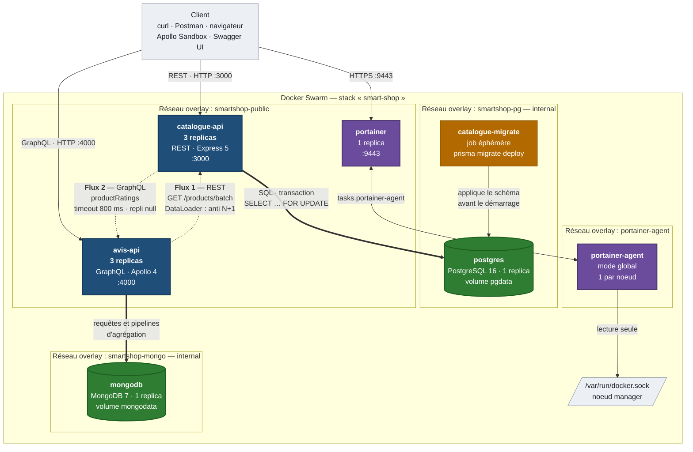

# Architecture de Smart-Shop

Diagramme de l'architecture **réellement déployée** — chaque composant
représenté existe dans `docker-stack.yml` et tourne sur le cluster.



> Le rendu PNG du même diagramme est disponible dans `docs/architecture.png`,
> pour les supports qui n'interprètent pas Mermaid (compte-rendu PDF,
> traitements de texte). GitHub, lui, affiche le diagramme ci-dessus
> directement.

---

## Lecture du diagramme

### Les deux chaînes principales

Le diagramme se lit sur deux colonnes indépendantes, qui ne se croisent
jamais au niveau des données :

```
Client ──REST :3000──►  catalogue-api ×3  ──SQL──►  PostgreSQL 16
Client ──GraphQL :4000─►  avis-api ×3      ──►      MongoDB 7
```

Chaque microservice possède **sa propre base**, et aucun ne lit ni n'écrit
dans celle de l'autre. Cette règle n'est pas qu'une convention de code : elle
est imposée par la topologie réseau (voir plus bas).

### Les flèches, et ce qu'elles signifient

| Trait | Signification |
|---|---|
| **Flèche pleine** | Trafic entrant du client vers une API |
| **Flèche épaisse** | Accès à une base de données |
| **Flèche pointillée** | Communication entre les deux microservices |
| Flèche fine | Administration et supervision |

### Les deux flux inter-services

Le sujet exige que les deux microservices communiquent entre eux. C'est le rôle
des **flèches pointillées**, et elles vont dans les deux sens.

**Flux 1 — `avis-api` → `catalogue-api`, en REST.** Quand une requête GraphQL
demande le champ `product` d'un avis, le resolver appelle
`GET /products/batch?refs=…`. Un **DataLoader** regroupe les appels : une
requête portant sur 50 avis déclenche **un seul** appel HTTP, pas 50.

**Flux 2 — `catalogue-api` → `avis-api`, en GraphQL.** `GET /products` enrichit
chaque produit de sa note moyenne via `productRatings`. Ce flux applique un
**timeout de 800 ms et un repli sur `rating: null`** : si `avis-api` est
indisponible, le catalogue continue de répondre en mode dégradé plutôt que de
tomber avec lui.

Les deux services s'adressent par **nom DNS Swarm** — `catalogue-api`,
`avis-api` — jamais par `localhost` ni par adresse IP. Le DNS interne de Swarm
résout chaque nom vers l'ensemble des tâches du service et répartit la charge
sur les trois replicas.

### Les quatre réseaux overlay

Les rectangles en arrière-plan sont les réseaux. Tous sont de type **overlay**,
conformément au sujet ; aucun réseau `bridge` ou `host` n'est déclaré.

| Réseau | `internal` | Rôle |
|---|---|---|
| `smartshop-public` | non | Trafic entrant et communication entre les deux API |
| `smartshop-pg` | **oui** | Accès à PostgreSQL |
| `smartshop-mongo` | **oui** | Accès à MongoDB |
| `portainer-agent` | non | Canal entre Portainer et son agent |

**Deux réseaux de données plutôt qu'un seul**, par choix délibéré. Avec un
réseau commun, `avis-api` pourrait ouvrir une connexion vers PostgreSQL : la
règle « une base par service » resterait alors déclarative, une convention que
rien n'empêche de violer. Séparés, l'isolation devient **topologique** —
`avis-api` n'est pas rattaché à `smartshop-pg`, il ne peut donc pas même
*résoudre* le nom `postgres`.

Les deux réseaux de données sont déclarés `internal: true`, ce qui coupe tout
accès depuis l'extérieur du cluster. Ni PostgreSQL ni MongoDB n'ont de bloc
`ports:` : leurs ports `5432` et `27017` sont injoignables depuis l'hôte.

### La réplication

Les deux API tournent en **3 replicas**, servis par le routing mesh de Swarm.
Une requête sur `localhost:3000` est distribuée automatiquement, et une tâche
en échec est retirée du load balancing sans intervention — c'est ce qui donne
les 100 % de disponibilité mesurés pendant la suppression d'un conteneur.

**Les bases restent à 1 replica.** Répliquer un conteneur PostgreSQL ou MongoDB
sur le même volume corromprait les données : deux instances écriraient
simultanément dans les mêmes fichiers. La haute disponibilité d'une base exige
un véritable cluster — Patroni pour PostgreSQL, replica set pour MongoDB — ce
qui dépasse le périmètre du sujet, lequel n'exige 3 replicas que pour « chaque
service applicatif (les deux API) ».

### Le job de migration

`catalogue-migrate` est un **service éphémère**, pas un service permanent. Il
applique le schéma PostgreSQL puis s'arrête, avec
`restart_policy: condition: none`. Il apparaît donc normalement en `0/1` dans
`docker service ls`.

Sa présence dans le diagramme n'est pas cosmétique : l'image de production de
`catalogue-api` **ne contient pas le CLI Prisma**, retiré pour la faire passer
de 604 à 322 Mo. Les migrations ont donc besoin d'une image dédiée, bâtie sur
la cible `migrator` du Dockerfile.

Docker Swarm ignorant `depends_on`, ce job ne suppose pas que PostgreSQL soit
prêt : il réessaie `prisma migrate deploy` jusqu'à 30 fois, toutes les 2
secondes. La commande étant idempotente, la rejouer sur une base à jour affiche
« No pending migrations » et sort en 0.

### La supervision

`portainer` est accompagné de `portainer-agent` en **`mode: global`** — une
tâche par nœud du cluster, présent et futur. C'est l'agent qui donne à
Portainer la vue sur les services, les nœuds et les journaux en temps réel.

L'agent est le **seul service autorisé à monter `/var/run/docker.sock`**.
Aucun service applicatif n'y a accès : un conteneur disposant de ce socket
contrôle le démon Docker de son hôte.

---

## Ce que le diagramme ne montre pas

Par souci de lisibilité, trois éléments réels n'y figurent pas :

- Les **volumes nommés** `pgdata`, `mongodata` et `portainer_data` — mentionnés
  dans les nœuds de base mais non représentés comme entités distinctes.
- Les **quatre secrets Docker** (`pg_password`, `mongo_password`,
  `catalogue_database_url`, `avis_mongodb_uri`), montés en fichiers sous
  `/run/secrets/` dans les conteneurs concernés.
- Les **sondes** `/health` et `/ready` exposées par les deux API, cibles du
  `HEALTHCHECK` Docker.
